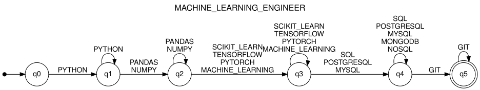

# Stage 3 — Qualification pattern recognition (finite automata)

Formal definitions, transition tables and diagrams of the four automata: [stage3_formalization.md](stage3_formalization.md).

## 1. Problem

Input: for each profile, the canonical qualifications of the résumé sorted in the order of that profile (`SkillNormalizer.sorted_by_profile`, Stage 2).
Output: `ACCEPTED` or `REJECTED` per profile, plus the first missing requirement when rejected. A résumé may satisfy more than one profile.

## 2. Approach

1. Describe the pattern of each profile as ordered steps `(name, qualifications, required)` (`Automata/patterns.py`).
2. Build one DFA per pattern with a single generic function (`Automata/automaton_builder.py`).
3. Keep only the qualifications that belong to the alphabet Σ of the profile and run the DFA on the sequence.
4. If the sequence is rejected, walk the automaton and report the required step where it stopped.

## 3. Modeling decisions

| Decision | Reason |
|---|---|
| Σ is the set of canonical qualifications of the profile | The input is the Stage 2 output, not raw text. |
| Pattern = at least one qualification per required step, in profile order | It is the regular language `O0* R1 (R1 ∪ O1)* R2 (R2 ∪ O2)* … Rk (Rk ∪ Ok)*`, where `Ri` is the union of the qualifications of the i-th required step and `Oi` the union of the optional steps placed after it (`O0` before the first). |
| Input already sorted by profile | The DFA becomes a chain of `k + 1` states (`k` = required steps). Without sorting it would need a state per subset of satisfied requirements (up to `2^k`). |
| State `qi` = "the first i required steps are satisfied" | Each state has a direct reading, which gives the explanation of a rejection. |
| Self-loop on the state reached after a required step | A résumé may list several qualifications of the same step (`JAVASCRIPT` and `TYPESCRIPT`). |
| Optional step = self-loop on the current state | Its qualifications are accepted and not required. |
| Qualifications outside Σ are removed before reading | Stage 2 places them at the end of the sorted list; they neither satisfy nor break the pattern. |
| DFA, not NFA or ε-NFA | There is no ε-transition and no (state, input) pair with two targets, so nondeterminism adds nothing. |
| Partial transition function | A missing transition rejects (implicit dead state); the diagrams stay readable. |
| Steps validated against `Normalization/ordering.py` | `validate_pattern` requires the steps to cover exactly the qualifications of the profile in its order; otherwise a correctly sorted input could be rejected. |

## 4. Construction

For a pattern with required steps `S1 … Sk` and optional steps `O`:

- `Q = {q0, …, qk}`, `q0` initial, `F = {qk}`.
- `Σ` = all qualifications of the pattern.
- For the i-th required step: `δ(q(i-1), a) = qi` and `δ(qi, a) = qi` for every `a` in `Si`.
- For an optional step placed after the i-th required step: `δ(qi, a) = qi` for every `a` in `O`.
- Every other pair is undefined.

## 5. Patterns

| Profile | Required steps (in order) | Optional steps |
|---|---|---|
| FULL_STACK_DEVELOPER | Frontend language, Frontend framework, Backend, Database, Version control | Markup and styles, REST API |
| MACHINE_LEARNING_ENGINEER | Language, Data processing, Machine learning, SQL database, Version control | NoSQL database |
| CYBERSECURITY_ANALYST | Operating systems, Scripting, Network analysis, Monitoring | Pentesting and scanning, Standards |
| DATA_ENGINEER | Languages, Storage, Processing, Orchestration, Version control | Cloud, Containers |

Full Stack and Machine Learning follow the qualification lists of the assignment, including its examples (`JS, React.js, NodeJS, Postgres, Git` and `PYTHON, PANDAS, TENSORFLOW, POSTGRESQL, GIT` are accepted).
For the two additional profiles, a step is required when the role cannot be performed without it.

## 6. Example: MACHINE_LEARNING_ENGINEER



| Read | PYTHON | PANDAS | TENSORFLOW | POSTGRESQL | GIT |
|---|---|---|---|---|---|
| State | q1 | q2 | q3 | q4 | q5 ∈ F |

`PYTHON, PANDAS, TENSORFLOW, POSTGRESQL, GIT` ends in `q5`: **ACCEPTED**.

For Wednesday Addams (`JAVASCRIPT, REACT, NODE_JS, POSTGRESQL, GIT`) the sequence kept for this profile is `POSTGRESQL, GIT`. `q0` has no transition on `POSTGRESQL`: **REJECTED**, missing step `Language`.

## 7. Implementation

| File | Content |
|---|---|
| `Automata/patterns.py` | Patterns of the four profiles and `validate_pattern` |
| `Automata/automaton_builder.py` | `build_profile_automaton(steps)` with `pyformlang` |
| `Automata/classifier.py` | `classify`, `missing_requirement` |
| `Automata/formalization.py` | Generates `stage3_formalization.md` and the diagrams |
| `classify_resume.py` | Stages 1, 2 and 3 on the sample résumés |
| `tests/test_automata.py` | Tests of patterns, automata, classification and pipeline |

```
python classify_resume.py
python -m pytest
python -m Automata.formalization
```

## 8. Limitations

- Only qualifications defined in the Stage 2 catalog are recognized.
- The automata check that qualifications are present; they do not check years of experience or education.
- A rejection reports only the first missing step.
