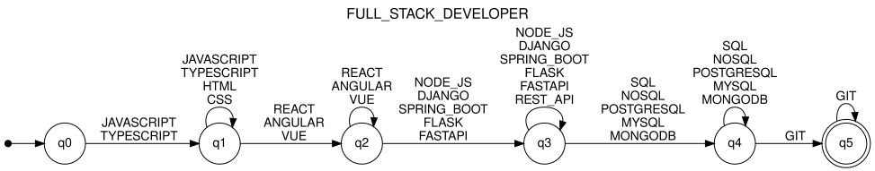
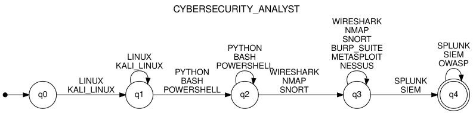
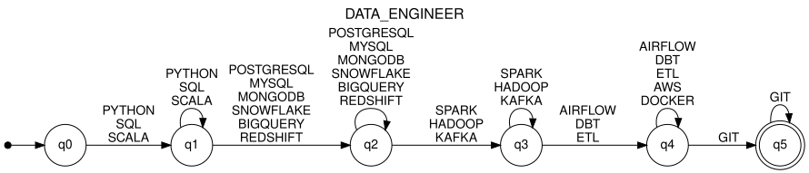

# Stage 3 — Formalization of the automata

> Generated by `python -m Automata.formalization`. Do not edit by hand.

Every automaton is a DFA M = (Q, Σ, δ, q0, F). In each table, a missing (state, input) pair rejects.

## FULL_STACK_DEVELOPER

M = (Q, Σ, δ, q0, F)

- **Q** (6 states) = {q0, q1, q2, q3, q4, q5}
- **Σ** (19 symbols) = {JAVASCRIPT, TYPESCRIPT, HTML, CSS, REACT, ANGULAR, VUE, NODE_JS, DJANGO, SPRING_BOOT, FLASK, FASTAPI, REST_API, SQL, NOSQL, POSTGRESQL, MYSQL, MONGODB, GIT}
- **q0** = q0
- **F** = {q5}

| State | Input | δ (next state) |
|-------|-------|----------------|
| q0 | JAVASCRIPT, TYPESCRIPT | q1 |
| q1 | JAVASCRIPT, TYPESCRIPT, HTML, CSS | q1 |
| q1 | REACT, ANGULAR, VUE | q2 |
| q2 | REACT, ANGULAR, VUE | q2 |
| q2 | NODE_JS, DJANGO, SPRING_BOOT, FLASK, FASTAPI | q3 |
| q3 | NODE_JS, DJANGO, SPRING_BOOT, FLASK, FASTAPI, REST_API | q3 |
| q3 | SQL, NOSQL, POSTGRESQL, MYSQL, MONGODB | q4 |
| q4 | SQL, NOSQL, POSTGRESQL, MYSQL, MONGODB | q4 |
| q4 | GIT | q5 |
| q5 | GIT | q5 |

**Type:** DFA (`is_deterministic()` = True): no ε-transitions and at most one next state per (state, input). Missing transitions reject.

**Pattern represented:**

| Step | Qualifications | Required | Effect |
|------|----------------|----------|--------|
| Frontend language | JAVASCRIPT, TYPESCRIPT | yes | q0 → q1 |
| Markup and styles | HTML, CSS | no | stays in q1 |
| Frontend framework | REACT, ANGULAR, VUE | yes | q1 → q2 |
| Backend | NODE_JS, DJANGO, SPRING_BOOT, FLASK, FASTAPI | yes | q2 → q3 |
| REST API | REST_API | no | stays in q3 |
| Database | SQL, NOSQL, POSTGRESQL, MYSQL, MONGODB | yes | q3 → q4 |
| Version control | GIT | yes | q4 → q5 |

## MACHINE_LEARNING_ENGINEER

M = (Q, Σ, δ, q0, F)

- **Q** (6 states) = {q0, q1, q2, q3, q4, q5}
- **Σ** (13 symbols) = {PYTHON, PANDAS, NUMPY, SCIKIT_LEARN, TENSORFLOW, PYTORCH, MACHINE_LEARNING, SQL, POSTGRESQL, MYSQL, MONGODB, NOSQL, GIT}
- **q0** = q0
- **F** = {q5}

| State | Input | δ (next state) |
|-------|-------|----------------|
| q0 | PYTHON | q1 |
| q1 | PYTHON | q1 |
| q1 | PANDAS, NUMPY | q2 |
| q2 | PANDAS, NUMPY | q2 |
| q2 | SCIKIT_LEARN, TENSORFLOW, PYTORCH, MACHINE_LEARNING | q3 |
| q3 | SCIKIT_LEARN, TENSORFLOW, PYTORCH, MACHINE_LEARNING | q3 |
| q3 | SQL, POSTGRESQL, MYSQL | q4 |
| q4 | SQL, POSTGRESQL, MYSQL, MONGODB, NOSQL | q4 |
| q4 | GIT | q5 |
| q5 | GIT | q5 |

**Type:** DFA (`is_deterministic()` = True): no ε-transitions and at most one next state per (state, input). Missing transitions reject.

**Pattern represented:**

| Step | Qualifications | Required | Effect |
|------|----------------|----------|--------|
| Language | PYTHON | yes | q0 → q1 |
| Data processing | PANDAS, NUMPY | yes | q1 → q2 |
| Machine learning | SCIKIT_LEARN, TENSORFLOW, PYTORCH, MACHINE_LEARNING | yes | q2 → q3 |
| SQL database | SQL, POSTGRESQL, MYSQL | yes | q3 → q4 |
| NoSQL database | MONGODB, NOSQL | no | stays in q4 |
| Version control | GIT | yes | q4 → q5 |

## CYBERSECURITY_ANALYST

M = (Q, Σ, δ, q0, F)

- **Q** (5 states) = {q0, q1, q2, q3, q4}
- **Σ** (14 symbols) = {LINUX, KALI_LINUX, PYTHON, BASH, POWERSHELL, WIRESHARK, NMAP, SNORT, BURP_SUITE, METASPLOIT, NESSUS, SPLUNK, SIEM, OWASP}
- **q0** = q0
- **F** = {q4}

| State | Input | δ (next state) |
|-------|-------|----------------|
| q0 | LINUX, KALI_LINUX | q1 |
| q1 | LINUX, KALI_LINUX | q1 |
| q1 | PYTHON, BASH, POWERSHELL | q2 |
| q2 | PYTHON, BASH, POWERSHELL | q2 |
| q2 | WIRESHARK, NMAP, SNORT | q3 |
| q3 | WIRESHARK, NMAP, SNORT, BURP_SUITE, METASPLOIT, NESSUS | q3 |
| q3 | SPLUNK, SIEM | q4 |
| q4 | SPLUNK, SIEM, OWASP | q4 |

**Type:** DFA (`is_deterministic()` = True): no ε-transitions and at most one next state per (state, input). Missing transitions reject.

**Pattern represented:**

| Step | Qualifications | Required | Effect |
|------|----------------|----------|--------|
| Operating systems | LINUX, KALI_LINUX | yes | q0 → q1 |
| Scripting | PYTHON, BASH, POWERSHELL | yes | q1 → q2 |
| Network analysis | WIRESHARK, NMAP, SNORT | yes | q2 → q3 |
| Pentesting and scanning | BURP_SUITE, METASPLOIT, NESSUS | no | stays in q3 |
| Monitoring | SPLUNK, SIEM | yes | q3 → q4 |
| Standards | OWASP | no | stays in q4 |

## DATA_ENGINEER

M = (Q, Σ, δ, q0, F)

- **Q** (6 states) = {q0, q1, q2, q3, q4, q5}
- **Σ** (18 symbols) = {PYTHON, SQL, SCALA, POSTGRESQL, MYSQL, MONGODB, SNOWFLAKE, BIGQUERY, REDSHIFT, SPARK, HADOOP, KAFKA, AIRFLOW, DBT, ETL, AWS, DOCKER, GIT}
- **q0** = q0
- **F** = {q5}

| State | Input | δ (next state) |
|-------|-------|----------------|
| q0 | PYTHON, SQL, SCALA | q1 |
| q1 | PYTHON, SQL, SCALA | q1 |
| q1 | POSTGRESQL, MYSQL, MONGODB, SNOWFLAKE, BIGQUERY, REDSHIFT | q2 |
| q2 | POSTGRESQL, MYSQL, MONGODB, SNOWFLAKE, BIGQUERY, REDSHIFT | q2 |
| q2 | SPARK, HADOOP, KAFKA | q3 |
| q3 | SPARK, HADOOP, KAFKA | q3 |
| q3 | AIRFLOW, DBT, ETL | q4 |
| q4 | AIRFLOW, DBT, ETL, AWS, DOCKER | q4 |
| q4 | GIT | q5 |
| q5 | GIT | q5 |

**Type:** DFA (`is_deterministic()` = True): no ε-transitions and at most one next state per (state, input). Missing transitions reject.

**Pattern represented:**

| Step | Qualifications | Required | Effect |
|------|----------------|----------|--------|
| Languages | PYTHON, SQL, SCALA | yes | q0 → q1 |
| Storage | POSTGRESQL, MYSQL, MONGODB, SNOWFLAKE, BIGQUERY, REDSHIFT | yes | q1 → q2 |
| Processing | SPARK, HADOOP, KAFKA | yes | q2 → q3 |
| Orchestration | AIRFLOW, DBT, ETL | yes | q3 → q4 |
| Cloud | AWS | no | stays in q4 |
| Containers | DOCKER | no | stays in q4 |
| Version control | GIT | yes | q4 → q5 |

